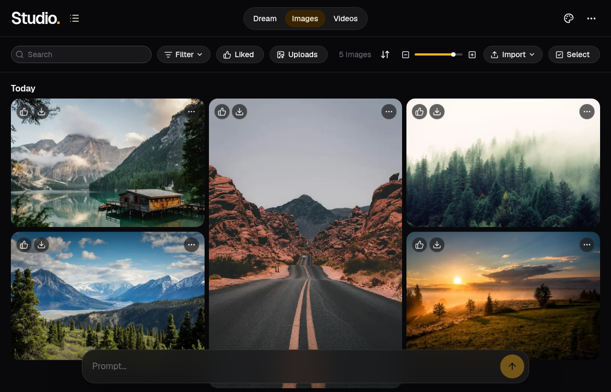
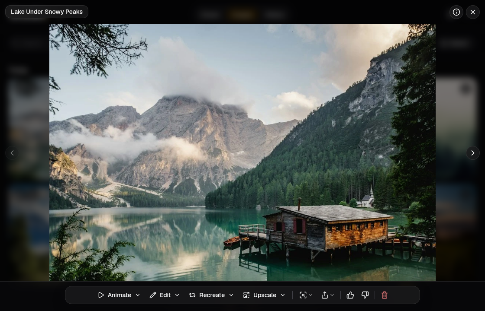

# Studio

Studio is a workspace for generating and refining images and videos with ComfyUI, Radiance or cloud providers. Chat clients can use the same workspace through MCP.

Create with models, LoRAs and reference images, compare variations in the viewer, and organise reusable Characters, Scenes and Outfits in the Library. Dream makes ideas to review when the queue is free.

## Run With Docker

On Linux with Docker Engine and an amd64 host, start a local Studio with a named volume.

```sh
docker run -d --name studio --restart unless-stopped --network host -e HOST=127.0.0.1 -v studio-data:/data ghcr.io/maxexcloo/studio:2026.11.22.16
```

Open <http://127.0.0.1:8787>. Studio runs on your computer and stores its media and settings in `studio-data`. To generate, [connect a worker](CONFIGURATION.md#workers) or [configure a cloud provider](CONFIGURATION.md#cloud-models). For network access, set up [accounts and HTTPS](CONFIGURATION.md#accounts--single-sign-on).

[Configuration](CONFIGURATION.md) · [Starter profiles](config/profiles/) · [Radiance](CONFIGURATION.md#radiance) · [Kubernetes](CONFIGURATION.md#runtime-control) · [LibreChat & Open WebUI](CONFIGURATION.md#mcp--chat-gateway) · [Releases](https://github.com/maxexcloo/studio/releases)

| Gallery                                          | Viewer                                                           |
| ------------------------------------------------ | ---------------------------------------------------------------- |
|  |  |

Screenshots use demo data and [Unsplash photographs](https://unsplash.com/license).

## Development

Install the [Node version in package.json](package.json) and use [Mise](https://mise.jdx.dev/).

```sh
mise run setup
mise run dev
```

Open the address printed by the development server. Use `mise run dev:demo` for a preview with sample data and no GPU. Run `mise run check` before opening a pull request.

Without Mise, install FFmpeg, run `npm ci` and start `node dev.mjs --demo`. The full check uses the shared tasks configured in [CI](.github/workflows/container.yaml).

## Credits & Licence

Studio is a hard fork of [HEISS UI](https://github.com/tristmeister/HEISS-UI), based on [J-AI Studio](https://github.com/jasperdevs/J-AI-Studio). Studio is licensed under [AGPL-3.0](LICENSE). The HEISS UI and J-AI Studio code, and the MantineHub theme adapted from RubixCube Innovations, keep their MIT copyright and licence notices in [NOTICE](NOTICE).
