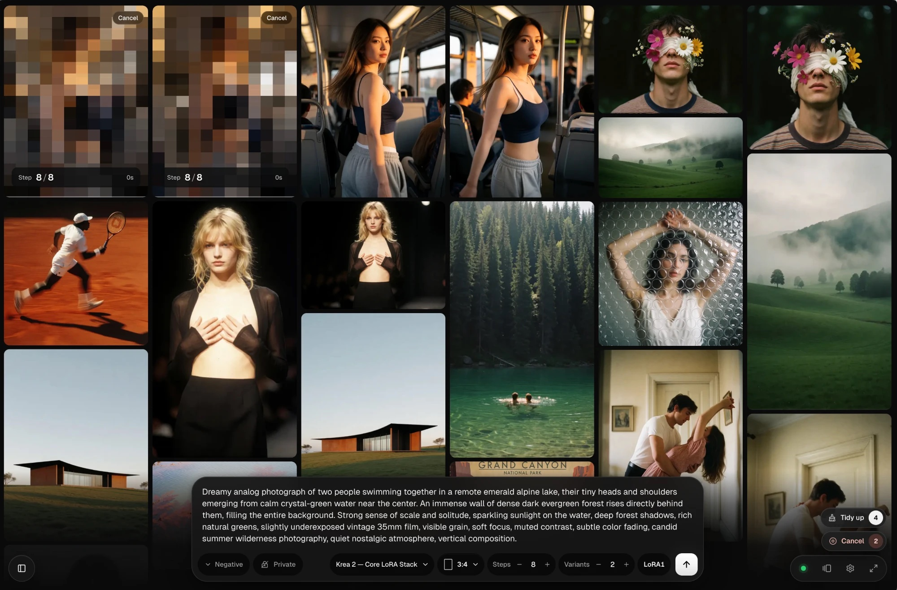
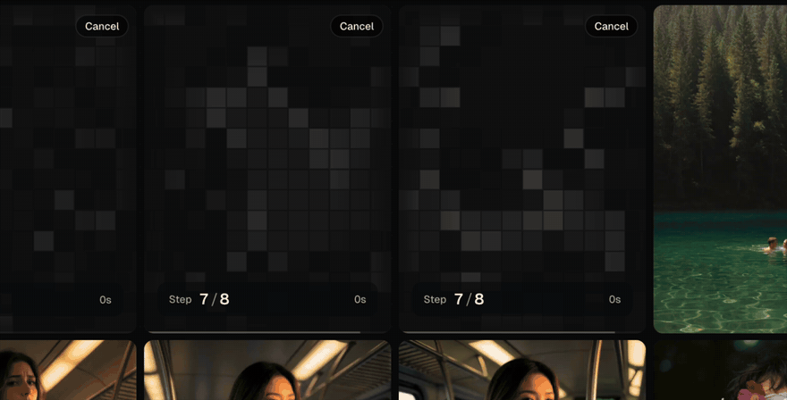
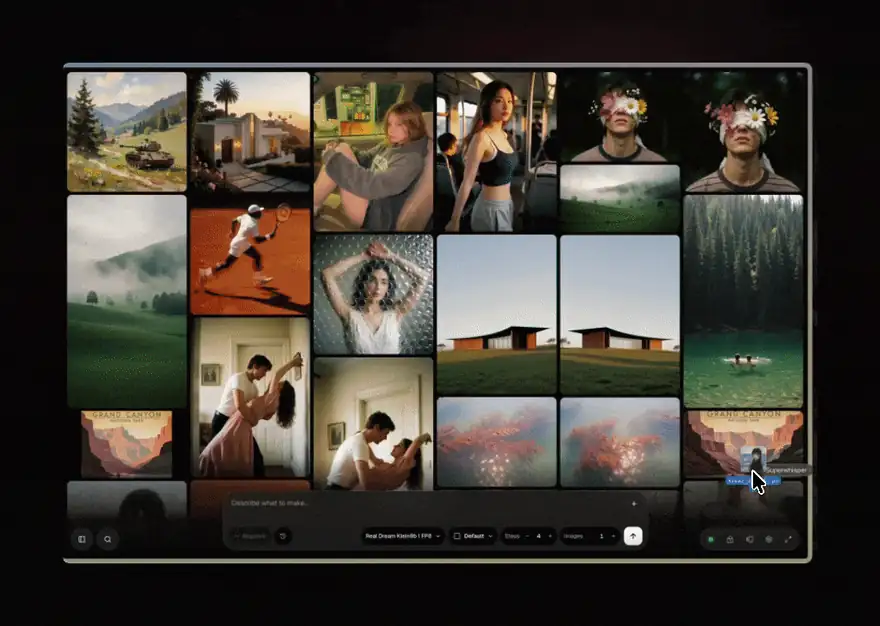

<p align="center">
  <picture>
    <source media="(prefers-color-scheme: dark)" srcset="./public/heiss-lockup-white.svg" />
    
  </picture>
</p>

<h3 align="center">ComfyUI, without the graph.</h3>

<p align="center">
  A local front end for ComfyUI.<br />
  28 model families work out of the box, and your own ComfyUI workflows come along. Write a prompt and watch it render.
</p>

<p align="center">
  <a href="https://github.com/tristmeister/HEISS-UI/releases/latest"></a>
  <a href="https://heiss-ui.vercel.app/"></a>
  <a href="https://discord.gg/Hf7ysvDeGa"></a>
  <a href="./LICENSE"></a>
</p>

<p align="center">
  <b><a href="#quick-start">Quick start</a> &nbsp;·&nbsp; <a href="#supported-models">Models</a> &nbsp;·&nbsp; <a href="#inpainting">Inpainting</a> &nbsp;·&nbsp; <a href="#bring-your-own-workflow">Workflows</a> &nbsp;·&nbsp; <a href="#troubleshooting">Help</a> &nbsp;·&nbsp; <a href="#faq">FAQ</a></b>
</p>

<p align="center">
  
</p>

<p align="center">
  <sub>Free and open source under MIT. Built on <a href="https://github.com/jasperdevs/J-AI-Studio">J-AI Studio</a> by Jasper.</sub>
</p>

---

HEISS UI sits on top of the ComfyUI you already run. You get a prompt box, a gallery and the settings that matter for the model you picked. ComfyUI still runs every job and keeps your nodes, models and outputs.

The node graph is for building workflows. HEISS UI is for the everyday loop of prompt, wait, look, tweak, and your workflows come along.

## Features

- **28 model families out of the box.** 21 for images and 7 for video (beta), from SD 1.5 and SDXL to Flux.2, Qwen-Image, Krea 2, Wan 2.2 and MiniMax H3, each with the settings from its makers' own templates. [The full list ↓](#supported-models)
- **Inpainting (beta).** Paint over the part of a picture that should change and say what it becomes. Only that part is redrawn; every other pixel stays exactly as it was. Works with 18 image families and needs no extra nodes. [How it works ↓](#inpainting)
- **Smart upscale, built in.** Pick **2K** or **4K** next to the size menu and every new picture comes out upscaled with SeedVR2, in the same run, with the time left on the clock. Any older picture upscales with one click. [More ↓](#smart-upscale)
- **Auto-grouping.** Pictures from similar prompts stack themselves into one tile once you're done with them, so a gallery of hundreds stays easy to scan. [More ↓](#auto-grouping)
- **Missing parts are a click away.** Pick a model to see what it still needs. Each part gets a Download or Install button, and **Get all** fetches the lot. With no model yet, the studio offers a first one to download. [What's covered ↓](#auto-downloads)
- **A phone studio.** On a phone the studio switches to a layout made for one thumb. Prompt, browse, share and upscale from the couch while the computer renders. [Set it up ↓](#on-your-phone)
- **Your studio over LAN.** Open HEISS UI from a laptop, tablet, phone or another desktop on your local network. The PC renders; every device uses the same models and gallery. Works over Wi-Fi or wired LAN. [Connect another device ↓](#connect-over-lan)
- **Bring your own workflow.** Import a ComfyUI workflow (API or visual JSON) and it becomes a set of controls, with your graph running underneath. [How it works ↓](#bring-your-own-workflow)
- **Hidden.** A locked place for images you keep to yourself. Generate into it or hide anything later, and unlock with Touch ID, Windows Hello or a password. [More ↓](#hidden)
- **Zen mode.** A fullscreen prompt and output view without the panels.
- **Civitai-ready images (beta).** New PNGs also carry the prompt, LoRAs and settings the way AUTOMATIC1111 writes them, so Civitai fills in an upload. Turn it on in Settings › Library.

LoRA stacks, live previews, video previews, recent prompts and gallery search are on the [website](https://heiss-ui.vercel.app/#features).

<p align="center">
  <a href="./docs/screenshots/realtime-generation.mp4"></a>
</p>

## Quick start

**1. Download** the zip for your system from the [latest release](https://github.com/tristmeister/HEISS-UI/releases/latest):

| Windows | macOS (Apple Silicon) | Linux |
| --- | --- | --- |
| [`heiss-ui-*-windows-x64.zip`](https://github.com/tristmeister/HEISS-UI/releases/latest) | [`heiss-ui-*-macos-arm64.zip`](https://github.com/tristmeister/HEISS-UI/releases/latest) | [`heiss-ui-*-linux-x64.zip`](https://github.com/tristmeister/HEISS-UI/releases/latest) |

The plain `heiss-ui-*.zip` (no system in its name) is for in-app updates; you can skip it.

**2. Unpack it and double-click Start HEISS UI** (`.bat` on Windows, `.command` on macOS, `.desktop` on Linux), or run `npm start` in the folder. Node.js and the packages are inside, so there's nothing else to install, and the studio opens in the browser.

**3. Have ComfyUI running.** ComfyUI on this computer connects automatically, at `http://127.0.0.1:8188` or ComfyUI Desktop's port 8000. On another machine or port, set its address in **Settings › Connection**.

Launcher won't open, or the window closes? [Troubleshooting › Starting HEISS UI](./docs/guides/TROUBLESHOOTING.md#starting-heiss-ui) covers macOS, Windows and Linux. To hand the whole setup to a coding agent (Claude Code, Codex), the [install section](https://heiss-ui.vercel.app/#install) has a prompt to paste.

<details>
<summary><b>No ComfyUI yet?</b></summary>

Get [ComfyUI Desktop](https://www.comfy.org/download), leave it running, and HEISS UI connects on its own.

</details>

<details>
<summary><b>Install from source</b></summary>

To follow `main` or change the code. This needs **Node.js 20.9+** (22 LTS or newer recommended); the downloads bring their own.

```bash
git clone https://github.com/tristmeister/HEISS-UI.git heiss-ui
cd heiss-ui
npm install
npm start
```

`npm start` builds the app the first time, then opens **http://localhost:8787** in the browser (or the next free port if that one is taken). Models, samplers and VAEs show up once ComfyUI is connected.

ComfyUI on another machine or port? Set its address in **Settings › Connection**, or copy `.env.example` to `.env` and set `COMFY_URL`.

</details>

## Supported models

28 families run out of the box with their makers' recommended settings, and a renamed file is still recognized.

**Image (21):** Krea 2, Anima, Z-Image, Flux.2 (Dev, Klein 4B, Klein 9B), SDXL (NoobAI, Illustrious, Pony and more), Pony V7, Chroma, Qwen-Image (and 2.1), Ideogram 4, MageFlow, ERNIE-Image, Lumina Image 2.0, Sana, HiDream I1, SD 3.5, Flux.1, SD 2.x and SD 1.5.

**Video (7, beta):** MiniMax H3, HunyuanVideo 1.5, Wan 2.2 (5B and 14B) and Wan 2.1, with text and image to video where the model has both.

Missing parts get a Download button. An unrecognized file can be given a type under **Settings › Models › Model types**. GGUF works through ComfyUI-GGUF; Nunchaku, NF4 and other formats that need their own loader nodes don't ([formats](./docs/guides/MODELS.md#formats)). Anything else runs as [your own workflow](#bring-your-own-workflow).

## Bring your own workflow

The built-in models cover the everyday loop. For anything custom, bring your graph.

1. **Export.** Build and test the graph in ComfyUI, then export it (**API format** works best; the regular workflow file works too).
2. **Drop.** Open the **Workflow Gallery** from the dock and drop the file on it, or paste the JSON.
3. **Check the connections.** The usual inputs are connected for you. Change any of them under **Change connections**, then import.

The workflow shows up in the model menu under **Your workflows** once the nodes it needs are installed.


<details>
<summary><b>What gets connected, and what the review shows</b></summary>

The prompt, negative prompt, size, seed, steps, CFG, sampler, scheduler, denoise, frames and start image are connected for you. The review shows what follows the studio's controls and what stays as saved, marks connections that were guessed, and lets you change any of them under **Change connections**. It also points out nodes that run code, touch files elsewhere or go online.

Only the connected inputs change; everything else runs as exported. If it uses a known model file you don't have, there's a Download button; otherwise the review says which folder the file belongs in.

</details>

<details>
<summary><b>Advanced: a <code>heissUi</code> block</b></summary>

To ship a workflow with its connections fixed, add a mapping to the exported JSON and drop the file into the `workflows/` folder:

```json
{
  "heissUi": {
    "id": "my-workflow",
    "name": "My Workflow",
    "kind": "image",
    "controls": {
      "prompt": { "node": "4", "input": "text" },
      "steps": { "node": "7", "input": "steps" },
      "seed": { "node": "7", "input": "seed" }
    }
  }
}
```

The [workflow guide](./workflows/README.md) covers the full control list, image-to-image inputs and LoRA loaders.

</details>

## Auto-downloads

Getting a new model running in ComfyUI usually means hunting for the right text encoder, the right VAE and a custom node pack or two. Here each part gets a button, and **Get all** fetches the lot. Nothing downloads until you press the button. [What's covered](./docs/guides/DOWNLOADS.md).


## Reference and start images

- **Reference images for edit models.** Flux.2 (Klein 4B, Klein 9B and Dev) and Qwen-Image 2.1 edit from reference images the way ComfyUI's own edit templates do.
- **Start images for everything else.** Every other built-in image model (Krea 2, SDXL, Flux, Z-Image and the rest) offers **Add start image**. The image then sits in the sidebar's Basics with **Change from the reference** right under it, for how far the result may move from it.
- **Paint on either one.** Hover a reference or start image and press the brush to [inpaint](#inpainting) just part of it.


<details>
<summary><b>Reference slots, the library and your workflows</b></summary>

- **Slots as you need them.** The composer opens a new reference slot each time you fill one, and the first reference frames the result.
- **A reference library in the composer.** Pick from uploads or your own generations, drop files in, or send any image from the viewer. An upscaled image is used upscaled.
- **Your workflows too.** Imported workflows can take reference images and let one set the output size and aspect.

</details>

## Inpainting

Change one part of a picture and keep the rest. Hover a reference or start image in the prompt bar and press the brush. Paint over what should change, then write what it becomes. Only the painted part is redrawn.

<p align="center">
  <a href="./docs/screenshots/inpainting.mp4"></a>
</p>

- **The rest stays pixel-exact.** HEISS UI renders a crop around what you painted at the model's full size and lays it back onto the original. The untouched part never softens or shifts in color, and a small fix gets the model's full detail.
- **Your models, no extra nodes.** 18 of the 21 image families inpaint with ComfyUI's own nodes, no inpainting checkpoint or node pack needed. Edit models (Flux.2 Dev, Klein 4B and 9B, Qwen-Image 2.1) paint on a reference image; SDXL, Krea 2, Z-Image, Flux.1, Qwen-Image, Chroma and the others on a start image. The model menu marks which models can.
- **A real brush.** Brush, eraser and hand, undo and redo, zoom and a brush size. It works with a finger on the phone too.
- **Two dials.** While a painted image is in the prompt bar, **Inpaint strength** (from touching it up to painting it anew, for models that take a start image) and **Edge softness** sit in the sidebar's Basics, under the image. On the phone they're in the Advanced sheet.

<details>
<summary><b>What it doesn't do (yet), and turning it off</b></summary>

Ideogram 4, MageFlow and Sana run their own graphs and can't inpaint, and neither can video models or imported workflows. There's no outpainting, layers or masking by selection; for that, [bring a workflow](#bring-your-own-workflow) or use a canvas tool next to HEISS UI on the same ComfyUI.

Inpainting is in beta and on by default. **Settings › Features › Inpainting** lists which of your models can inpaint and turns the brush off everywhere.

</details>

## Smart upscale

Bigger, sharper pictures with [SeedVR2](https://github.com/numz/ComfyUI-SeedVR2_VideoUpscaler), without leaving the studio.

- **2K or 4K for every new picture.** Pick **None**, **2K** or **4K** next to the size menu (on the phone, in the create sheet). The upscale is part of the run, so you can close the page and it still finishes. The next run waits for it, and if you stop it or it fails, you keep the picture at its generated size.
- **Any picture, one click.** The upscale arrow on a tile or in the viewer upscales anything already in the gallery, Hidden included. The upscale is saved next to the original, and a slider drags across both to show what changed.
- **Time left, not a spinner.** Upscale times are learned per model and size, so the ring, the buttons and the queue count down the seconds that are left.
- **Set up when you need it.** Picking 2K or 4K without the SeedVR2 nodes or model offers to install them, with sizes shown before anything downloads.


<details>
<summary><b>Effort, faces and when it's skipped</b></summary>

| | Scale | Model |
| --- | --- | --- |
| **Fast** | 1.5× | SeedVR2 3B, the least graphics memory |
| **Balanced** (and **2K**) | 2× | SeedVR2 7B fp8 |
| **High** (and **4K**) | 3× | SeedVR2 7B fp16, the slowest and the most memory |

The effort for the upscale arrow is set under **Settings › Features › Smart upscale**, where it can also be turned off. A **face detail pass** (beta) redraws small faces before the upscale; it needs the Impact Pack and Impact Subpack nodes. Imported workflows get 2K and 4K too. A run whose size is decided by a reference image (edit models) or by a painted mask skips the 2K/4K pick.

</details>

## Auto-grouping

Making ten takes of one idea fills a gallery fast. With auto-grouping on, pictures from similar prompts, even ones you tweak as you go, fold into one tile once you stop working on them.

- **Stacks with a count.** A stack shows as a photo with two edges under it, or as a cover flow, with the number of pictures in the corner.
- **Skim without opening.** Slide the pointer along the bottom of a stack to flip through it. Open it to spread the pictures out, or **Unstack** to keep them apart.
- **It knows what changed.** Similar prompts group together, and shared boilerplate like "masterpiece, 8k" barely counts. Coming back to a prompt the next day starts a new stack.
- **Your files stay put.** Grouping changes no files. Switch it off and the gallery is as it was.

Turn it on with the stack button next to gallery search, or under **Settings › Library › Auto-grouping**, where you also pick the photo or cover-flow look.


## On your phone

On a phone the studio switches to its own layout. Prompt, browse, share and upscale while your PC renders.

Set up [LAN access](#connect-over-lan) first, then scan the QR code shown in **Settings › Connection** with your phone and sign in. Both devices need to be on the same trusted network.


<details>
<summary><b>The phone layout</b></summary>

The gallery runs edge to edge, and one **Describe…** pill opens the prompt, reference image, workflow, shape, number of images and Smart upscale's None, 2K or 4K, with Advanced one link away. The brush on a reference opens the inpaint studio for your finger. Long press a tile to Share, Upscale, Star, Use these settings, Hide or Delete. In the viewer, pinch to zoom and swipe or flick to the next picture. Share hands the file to the phone's share sheet. Added to the home screen, it opens full screen. A ring around Generate shows progress while you browse.

**Use the full studio** under More switches a phone to the complete layout, and `?phone=1` shows the phone studio on any screen.

</details>

## Connect over LAN

Use a laptop, tablet, phone or another desktop on the same local network to prompt, browse the gallery and upscale. HEISS UI and ComfyUI keep running on your PC with its models and outputs; the other device needs only a browser.

1. On the PC running HEISS UI, open **Settings › Connection** and turn on **Open on other devices**.
2. In the same settings, set a **studio password** under **Signing in**.
3. On your other device, open the **network address** shown in Connection (for example, `http://192.168.1.20:8787`) and sign in with that password. Use your PC’s listed address, not `localhost`.

Laptops and desktops get the full studio and phones get the phone layout. Only enable access on a network you trust. Admin controls stay at the PC unless you allow them for signed-in devices.

<details>
<summary><b>More on setup</b></summary>

Switching on **Open on other devices** restarts HEISS UI on your network. For a single session, start with `npm start -- --lan` (or `npm run dev:lan` in a checkout) instead. The first time, your system may ask whether Node.js can accept connections; allow it for private networks.

</details>

Signing in, admin rights, HTTPS and proxies are covered in [SECURITY.md](./docs/guides/SECURITY.md#other-devices-signing-in-admin-https-and-proxies).

## Hidden

Hidden is a place for the images you'd rather keep to yourself. Open it from the lock in the dock. The first time, it walks you through a password and, where the browser supports it, Touch ID or Windows Hello.


- **Generate straight into it.** Anything made while Hidden is open renders there, with the same live previews, and stays out of the gallery.
- **Hide from the gallery.** The eye on a tile (or in the viewer) moves an image into Hidden, or back out. Upscale, compare, remix and video all work inside it.
- **Locked means out of sight.** A locked Hidden shows no thumbnails and no count, and its prompts stay out of Recent prompts. It locks after a while without activity (Settings › Hidden › Auto-lock), or right away with **Lock**.

Images, prompts, settings and upscales in Hidden are encrypted on disk with a key that only your password or a passkey can open, and ComfyUI's own copies are removed. Hidden keeps things out of casual view; it isn't a forensic guarantee against an administrator, disk recovery or backups taken mid-run. [SECURITY.md](./docs/guides/SECURITY.md) has the details, including what passkeys need.

There's no password reset. If the password and every passkey are lost, **Erase Hidden** in Settings › Hidden starts over and takes everything in Hidden with it.

## Updating

**Settings › About › Install update** updates a downloaded release in place, and a Git checkout too as long as it has no local changes. A downloaded release also offers new versions in a small pill at the top.

Updating a checkout by hand is in [Troubleshooting](./docs/guides/TROUBLESHOOTING.md#a-git-checkout-wasnt-updated).

## Configuration

Copy `.env.example` to `.env` when you need different ports or paths.

```bash
COMFY_URL=http://127.0.0.1:8188
HOST=127.0.0.1
PORT=8787
HEISS_DATA_DIR=./data
COMFY_OUTPUT_DIR=
```

Everything else (the output folder, other devices, HTTPS, the Hugging Face token, proxies) is in [CONFIGURATION.md](./docs/guides/CONFIGURATION.md).

A Windows shortcut that starts ComfyUI and HEISS UI together is in [WINDOWS-SHORTCUT.md](./docs/guides/WINDOWS-SHORTCUT.md).

## Troubleshooting

[TROUBLESHOOTING.md](./docs/guides/TROUBLESHOOTING.md) covers the common problems, from ComfyUI not being found, the port and Node.js to each kind of failed generation, downloads and node packs, updates and phones. A failed card links to its section.

- **No models showing up?** Make sure ComfyUI is running. On this computer it connects on port 8188 or 8000; anywhere else, set its address in Settings › Connection. After adding files, use **Settings › Models › Rescan**.
- **Asking for help?** **Settings › About › Copy diagnostics** copies versions, system and GPU, without prompts or images. Paste it on the [board](https://heiss-ui.vercel.app/board/) or in the [Discord](https://discord.gg/Hf7ysvDeGa).

## Feedback and community

Found a bug, want a feature, or not sure how something works? Post it on the **[feedback board](https://heiss-ui.vercel.app/board/)**: it's public, needs no account, and shows what's planned, in progress and done. Rather talk it through? **[Join the Discord](https://discord.gg/Hf7ysvDeGa)**.

From the app, **Idea or bug?** at the bottom of the Settings sidebar and **Report bug** on a failed generation send a post with the details filled in, and you see everything that goes with it before you send. GitHub issues work as well.

## FAQ

The [website FAQ](https://heiss-ui.vercel.app/#faq) answers the common questions.

<details>
<summary><b>Why "HEISS"?</b></summary>

*Heiß* is German for hot. Hence the steaming cup.

</details>

## Development

```bash
npm install
npm run dev
```

`npm run dev` starts Vite and the local API server together, and `npm test` runs the server and script tests. Adding a model family is mostly data: [MODELS.md](./docs/guides/MODELS.md) walks through it. Contributions are welcome. See [CONTRIBUTING.md](./docs/guides/CONTRIBUTING.md), and leave generated media, model files, logs and `.env` files out of commits.

## Credits

HEISS UI started as a fork of **[J-AI Studio](https://github.com/jasperdevs/J-AI-Studio)** by **[Jasper](https://github.com/jasperdevs)**. The prompt-first idea and much of the foundation are his work. If HEISS UI is useful to you, go give the original a star too.

Built on [ComfyUI](https://github.com/comfyanonymous/ComfyUI).

## License

[MIT](./LICENSE). The original J-AI Studio copyright notice is kept alongside HEISS UI's, as the license asks.

The downloads include an [FFmpeg](https://ffmpeg.org) build (via [ffmpeg-static](https://github.com/eugeneware/ffmpeg-static)) for video previews. It's licensed separately under the GPL, with its license and source at those links.
